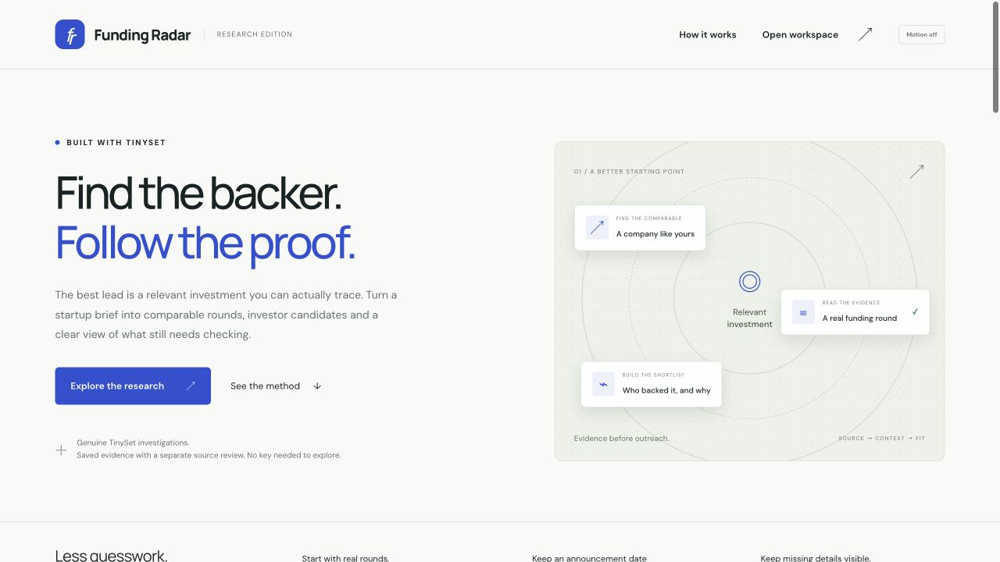

# Funding Radar

Find the investment behind the investor. Funding Radar helps a founder turn a startup brief into comparable funding rounds, inspect who backed them and build a shortlist they can explain before sending the first email.

An investor name is only the beginning. A useful match needs a real investment, the person responsible, a cheque policy that fits the stage and a route intended for founders. Funding Radar puts those facts beside their sources and keeps uncertainty visible. In the climate example, Amperon's apparent 2026 announcement resolves to a 2023 round and leaves the recent-deal evidence. The review changes the shortlist without rewriting what the research originally returned.

**Submitted on 11 November 2026; in review.** Three original saved TinySet investigations now have **10 / 10 / 10 source-supported recent comparable companies** and a separate selected, source-reviewed investor shortlist. Four firms have usable, qualified records: **AlleyCorp, Pi Labs, Realyze Ventures and Arkam Ventures**. Volve remains conditional for the UK example. These are selected backers, not an exhaustive market list or a promise of funding.



[Watch the 100-second demo](funding-radar/docs/media/funding-radar-demo.mp4) · [Reviewed shortlist](funding-radar/docs/media/shortlist.png) · [Fourth recording](funding-radar/docs/media/live-recording.png)

The silent, captioned demo uses actual browser captures. It follows the source-review workflow and includes the genuine new research run. Open the saved workspace below to inspect the evidence yourself, with no key or credits.

## Open the workspace

Use **Node.js 22 or newer**. Get the [public source](https://github.com/himanshu748/funding-radar), then run the saved workspace locally:

```sh
git clone https://github.com/himanshu748/funding-radar.git
cd funding-radar
npm ci --ignore-scripts
FUNDING_RADAR_LIVE=0 BOUNTY_POOL_LIVE=0 node --import tsx funding-radar/src/server.ts
```

Open [http://127.0.0.1:4391](http://127.0.0.1:4391). Saved research, its exports and local planning need no API key, login or provider credits. The server binds to the local loopback interface. Use `FUNDING_RADAR_PORT=4392` if the default port is occupied. Environment files are not loaded automatically.

1. Choose **Climate & energy**, then inspect Amperon's original claim beside its dated review.
2. Open **suena energy** or **Deftpower**. Their records say **Public-source addition**, with separate sources, dates and fit qualifications.
3. Open **Investor candidates** and its **Reviewed shortlist**. Inspect Pi Labs or Realyze for the comparable investment, named responsible person, scoped cheque policy, stage/geography fit and published founder route.
4. Download JSON or CSV. Original TinySet rows and ordinary-web additions keep separate origins; the JSON also retains the reviewed shortlist and its qualifications.
5. Choose **Security & compliance** for the fourth, genuine 11 November recording. Its company review is separate from the original claims. SignalFire has a sourced conditional watchlist record; no investor is approach-ready for this input. Opening it starts no new run.
6. Choose **Prepare your own brief**. A local plan costs nothing. A separate **Run paid research** action is available only with explicitly enabled live configuration and an authorized private grant.

The general live path now supports one request identity, job status, cancellation requests, result inspection and JSON/CSV exports. It is disabled by default. One separately authorized genuine test completed through the real UI and JSON/CSV downloads. The desktop browser pass, demo review and local software checks are complete. The public source, demo and all three required shares are released. Final checks passed, and the owner submitted the entry on 11 November; the portal shows IN REVIEW. [Live setup and lifecycle limits](funding-radar/docs/LIVE_RESEARCH.md).

Tabs support arrow keys, Home and End. Dialogs support Escape and focus return. Search, status filters, empty states, loading errors and a manual motion control are implemented. Mobile sizing and operating-system reduced-motion emulation remain unverified.

## Follow the evidence

The saved investigations retain their **8 May 2025 through 8 November 2026** window and original 8 November collection times. Original-row reviews are dated 10 November; public-web additions and selected investor reviews are dated 11 November.

| Startup brief                            | Original TinySet rows | Reviewed original companies | Public-web additions | Combined reviewed recent | Presented records |
| ---------------------------------------- | --------------------: | --------------------------: | -------------------: | -----------------------: | ----------------: |
| US seed developer/code-review software   |                    10 |                           8 |                    2 |                       10 |                12 |
| UK seed climate/energy software          |                    10 |                           8 |                    2 |                       10 |                12 |
| India Series A fintech/payments software |                    10 |                           8 |                    2 |                       10 |                12 |

For the three original demonstrations, TinySet supplied thirty rows across three genuine runs. Six companies were researched separately through ordinary public websites; they are **not TinySet output** or proof of new automated discovery. Earlier 9 / 9 / 9 reconciliation counts describe parsed provider claims, not current reviewed coverage. A separate historical TinyFish Fetch audit retrieved twelve pages and rejected eight redirects. Retrieval alone does not prove a funding claim.

The **Reviewed shortlist** uses source-reviewed profiles bound to the exact startup and company-evidence snapshot. Its explained fit score is separate from the older heuristic candidate scores. A historical deal leader may have moved firms; a typical cheque range is not the actual cheque in a round; a participating firm is not automatically the overall round lead. Those distinctions remain in each investor inspector. Published contact routes are recorded, never contacted by the app. [Evidence and qualifications](funding-radar/docs/EVIDENCE.md) · [Judge path](funding-radar/docs/JUDGE_GUIDE.md).

## A different brief, one genuine run

On **11 November**, the owner-authorized live test researched a US seed startup automating security-compliance evidence and vendor questionnaires for SaaS teams. It requested twenty rows and returned **nineteen**. The raw parser retained **sixteen** recent-company claims; a later, separately dated public-web review supports **seventeen** recent comparable companies, with **zero public-source additions**. RiskFront and Certivo are excluded for product fit, and date corrections preserve the raw claims. This recording uses its own **11 May 2025 through 11 November 2026** window.

The live UI, result inspection and real JSON/CSV downloads were confirmed. The [saved export](funding-radar/evidence/recorded-investigations/fresh-security-export.json) and [separate company review](funding-radar/evidence/recorded-investigations/fresh-security-review.json) retain that evidence for keyless replay; opening the recording does not rerun TinySet. A separate [SignalFire investor review](funding-radar/evidence/recorded-investigations/fresh-security-ranking.json) now connects Conveyor's investment to Tony Pezzullo's transaction-specific responsibility, a dated USD1M–5M seed-plan range and an AI Lab founder route. It stays **conditional, with zero approach-ready investors**: the input does not establish AI-native eligibility, and current programme intake is unconfirmed. Conveyor's Series B, Tony's Principal-at-round/current-Partner distinction and the programme-specific contact limits remain visible. Other raw investor fields are not automatically verified; the first three cases' four usable firms do not transfer to this brief. [Genuine test receipt](funding-radar/evidence/readiness-final-2026-11-11/live-test.json).

## Verification and remaining gates

The [final local verification](funding-radar/evidence/readiness-final-2026-11-11/verification.json) records **131 passing tests**, TypeScript, build and formatting. A [fresh copied clean installation](funding-radar/evidence/readiness-final-2026-11-11/clean-install.json) also passed all 131 tests and the same checks. The [current desktop browser pass](funding-radar/evidence/readiness-final-2026-11-11/browser-final.json) passed **15 / 15 checks**; [actual JSON/CSV downloads](funding-radar/evidence/readiness-final-2026-11-11/download-final.json) passed **12 content checks**. The [demo review](funding-radar/evidence/readiness-final-2026-11-11/demo-verification.json), [51-file preservation check](funding-radar/evidence/readiness-final-2026-11-11/preservation-final.json) and [artifact scan](funding-radar/evidence/readiness-final-2026-11-11/artifact-scan-final.json) are complete. The scan has no unresolved findings; its acknowledged credential-like test fixture is synthetic.

An independent [anonymous public clone](funding-radar/evidence/release/public-clone-verification.json) of commit `5e04ec47fae84124484f31aa52bc27656df927d8` passed setup, all 131 tests, TypeScript, build and formatting. All 84 runtime/data/test hashes matched the verified source, and the public video download matched the reviewed file. No credentials, provider run or hosted application was involved.

The earlier [11 November browser pass](funding-radar/evidence/completion-2026-11-11/browser-checks.json) recorded **19 successful UI assertions, six real downloads and 22 downloaded-content checks**, with zero provider operations. It retains five corrected harness expectations. Its [90-test software receipt](funding-radar/evidence/completion-2026-11-11/verification.json) and [preservation check](funding-radar/evidence/completion-2026-11-11/preservation-check.json) describe that earlier source snapshot, before the new shortlist and general live-session work.

```sh
npm test
npm run typecheck
npm run build
npm run format:check
```

The [independent technical review](funding-radar/evidence/readiness-final-2026-11-11/INDEPENDENT_FINAL_REVIEW.md) found no new runtime blocker for the disclosed research workbench. Generic research dispatch is real; confirming funding facts and enriching investor records remain human-reviewed steps. The fourth case's conditional watchlist does not establish an actionable recommendation for every new input.

A fresh result starts with its own provenance and independent review pending; it does not inherit the saved cases' ten-company counts or reviewed investors. The brief parser preserves the full input when its limited vocabulary cannot identify a structured field. New job records and in-session results live in server memory; export before restarting. Bundled recordings are separate saved snapshots. An uncertain provider outcome must be reconciled before another start.

The owner separately authorized one bounded **$2** live test on 11 November, raising the new-bounty aggregate ceiling to **$16**. The one test completed with its full **$2 reservation retained** and a **$1.90 row-count estimate**, neither a verified invoice nor a confirmed charge. Seven prior control files stayed unchanged. No further provider call is authorized. That authorization does not reopen earlier allowances. The failed 10 November empty-dataset attempt remains historical, with its **$1.80 reservation**, not an invoice or verified charge. Its cause remains unknown. No automatic retry, purchase or billing change is part of this build. [Attempt and allowance details](funding-radar/docs/EVIDENCE.md#attempts-and-allowance).

Funding Radar is **submitted on 11 November 2026 and in review**. The [public GitHub build](https://github.com/himanshu748/funding-radar) is independently clone-verified, and the [X video share](https://x.com/jhahimanshu653/status/2120448778662715464) is posted and read back. The [LinkedIn video share](https://www.linkedin.com/feed/update/urn:li:activity:7526216239652950016/) is also confirmed. The [TinyFish Discord showcase](https://discord.com/channels/1200506685236711554/1570009925848006777) is also published and read back with the approved video. The actual form requires build, LinkedIn and X links plus notes of at most 2,000 characters; media is optional, up to five files of 25 MB each. Owner publication approval is recorded. The public-link, eligibility, cutoff, final-form and independent readiness checks are complete. The owner submitted the 1,804-character notes, exact public URLs and video. The portal retained them and shows IN REVIEW. [Submission preparation](funding-radar/docs/SUBMISSION_DRAFT.md).

Submission status: [confirmed in review](funding-radar/evidence/release/submission-confirmation.json). Earlier readiness and form receipts remain dated pre-submission evidence. The public clone suite verifies code at `5e04ec4`; later prose and receipts preserve the same 84-file runtime/data/test snapshot. No new provider execution is implied.
